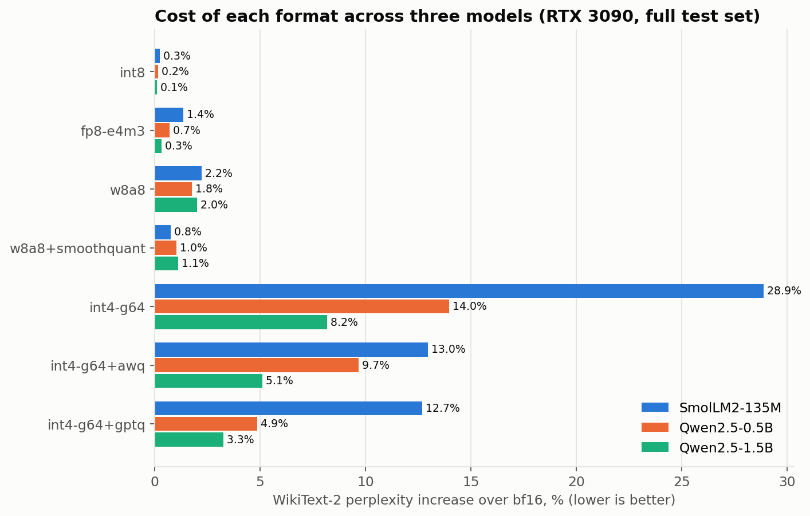
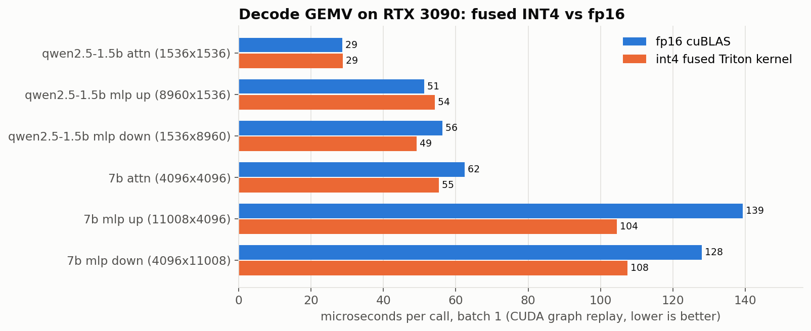
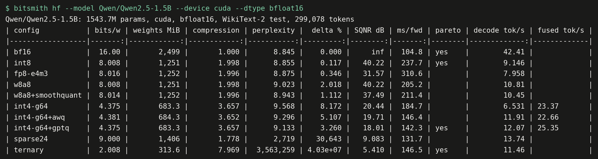
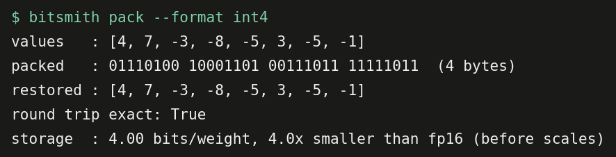
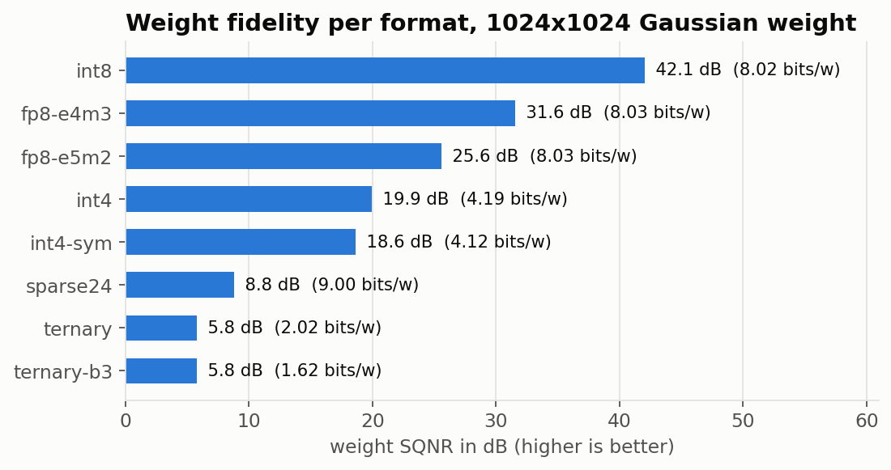
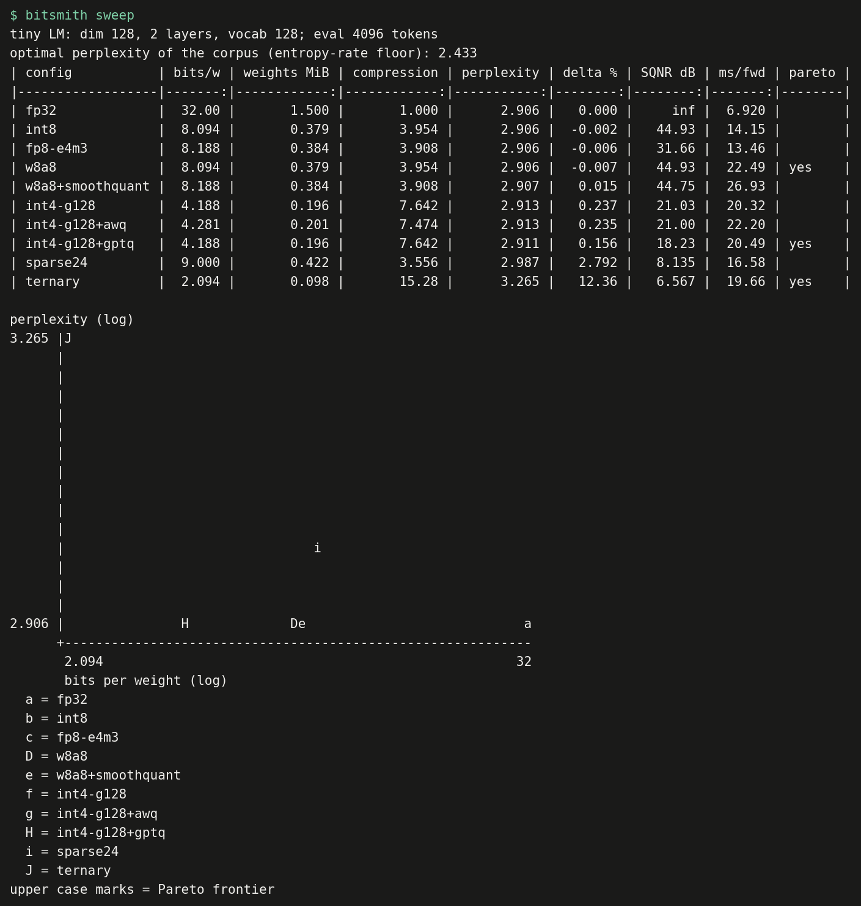

# bitsmith

**LLM weight quantization from first principles, in pure PyTorch, with a fused INT4 GPU kernel.**


[](https://github.com/yashwanthdevavarapu/bitsmith/actions/workflows/ci.yml)


bitsmith implements the core of modern LLM compression in readable Python, runs it on
real models, and reports what each technique actually costs:

- **Formats**: INT8, group-wise INT4, OCP FP8 (E4M3 and E5M2, bit exact), BitNet style
  ternary, and 2:4 structured sparsity
- **Storage**: real sub-byte packing into `uint8` (INT4 nibbles, 2-bit and base-3 ternary,
  2:4 values plus index metadata), so checkpoints actually shrink on disk
- **Calibration**: SmoothQuant, AWQ and GPTQ (block-sequential, with activation ordering)
- **Kernels**: a fused INT4 dequantize + matmul in Triton, up to 1.33x faster than fp16 cuBLAS at batch 1
- **Evaluation**: full WikiText-2 perplexity on three models, kernel timing against the
  bandwidth roofline, and a Pareto sweep
- **Engineering**: 209 CPU tests at 97% coverage plus 85 GPU tests, CI on Linux, Windows and
  macOS, and 10 architecture decision records

The core library depends only on `torch` and `numpy`.

---

## Contents

- [Results](#results)
- [Quickstart](#quickstart)
- [Command line](#command-line)
- [Python API](#python-api)
- [How it works](#how-it-works)
- [More results](#more-results)
- [Project layout](#project-layout)
- [Testing and CI](#testing-and-ci)
- [Design decisions](#design-decisions)
- [Reproducing everything](#reproducing-everything)
- [Limitations](#limitations)

---

## Results

### Quality on three models

Full WikiText-2 raw test split (about 300,000 tokens), window 1024, stride 512, bf16 on an
NVIDIA RTX 3090. INT4 uses group size 64. Calibration uses 128 sequences of 512 tokens from
the train split. `lm_head` stays in bf16. Bits per weight include every scale, zero point
and metadata byte. Cells show the perplexity increase over bf16 (lower is better).



| Config | Bits/weight | SmolLM2-135M | Qwen2.5-0.5B | Qwen2.5-1.5B |
|--------|------------:|-------------:|-------------:|-------------:|
| bf16 baseline (perplexity) | 16 | 14.82 | 12.51 | 8.84 |
| int8 | 8.02 | +0.3% | +0.2% | +0.1% |
| fp8-e4m3 | 8.05 | +1.4% | +0.7% | +0.3% |
| w8a8 (int8 weights and activations) | 8.02 | +2.2% | +1.8% | +2.0% |
| w8a8 + SmoothQuant | 8.05 | **+0.8%** | **+1.0%** | **+1.1%** |
| int4, round to nearest | 4.38 | +28.9% | +14.0% | +8.2% |
| int4 + AWQ | 4.40 | +13.0% | +9.7% | +5.1% |
| int4 + GPTQ | 4.38 | **+12.7%** | **+4.9%** | **+3.3%** |
| 2:4 sparse, no fine tuning | 9.00 | model breaks | model breaks | model breaks |
| ternary, post training | 2.02 | model breaks | model breaks | model breaks |

**What the numbers say**

1. **8-bit weights are close to free.** INT8 costs 0.2% to 0.3% at 2x compression over
   bf16. FP8 E4M3 costs a little more, since 3 mantissa bits give coarser steps near the
   per-channel maximum than 8 uniform bits.
2. **SmoothQuant fixes activation quantization.** Quantizing activations to INT8 as well
   (W8A8) raises the loss from about 0.2% to about 2%, because a few activation channels are
   far larger than the rest. Moving that range into the weights roughly halves it or better.
3. **INT4 needs calibration, and GPTQ wins.** Round to nearest costs 8% to 29% on these
   small models. Block-sequential GPTQ with activation ordering cuts that by 2.3x to 2.9x
   and beats AWQ on every model.
4. **Bigger models tolerate INT4 better.** The round-to-nearest gap shrinks steadily from
   135M to 1.5B parameters.
5. **Ternary and 2:4 need training.** Both formats are stored and executed correctly (the
   tests prove the round trips are exact), but they destroy a model that was not trained
   or fine tuned for them.

Raw data: [`results/gpu_*.json`](results). Full tables with timing:
[SmolLM2-135M](results/gpu_smollm2_135m.txt), [Qwen2.5-0.5B](results/gpu_qwen2.5_0.5b.txt),
[Qwen2.5-1.5B](results/gpu_qwen2.5_1.5b.txt).

### Speed: fused INT4 kernel on an RTX 3090

The reference runtime unpacks the whole weight before each matmul, so it is 5x to 20x
slower than fp16. The Triton kernel ([`kernels/int4_triton.py`](src/bitsmith/kernels/int4_triton.py))
dequantizes in registers instead. Times are CUDA graph replays of a single layer, batch 1:



| Layer (out x in) | fp16 cuBLAS | int4 reference | int4 fused | Fused vs fp16 |
|------------------|------------:|---------------:|-----------:|--------------:|
| Qwen2.5-1.5B attention (1536 x 1536) | 28.7 us | 155.6 us | 28.8 us | 1.00x |
| Qwen2.5-1.5B MLP up (8960 x 1536) | 51.2 us | 791.5 us | 54.3 us | 0.94x |
| Qwen2.5-1.5B MLP down (1536 x 8960) | 56.3 us | 797.7 us | 49.2 us | **1.15x** |
| 7B attention (4096 x 4096) | 62.5 us | 959.5 us | 55.3 us | **1.13x** |
| 7B MLP up (11008 x 4096) | 139.3 us | 2,546 us | 104.4 us | **1.33x** |
| 7B MLP down (4096 x 11008) | 128.0 us | 2,528 us | 107.5 us | **1.19x** |

At batch 1 the kernel is up to 1.33x faster than cuBLAS on 4 of 6 layers and within 6% on
the other two, while reading 3.8x fewer weight bytes, and it is 5x to 24x faster than the
reference path. It reaches about 25% of the 3090's 936 GB/s,
against 70% for cuBLAS fp16, so a hand-tuned CUDA kernel (as in Marlin) would be several
times faster still. At 512 rows (prefill) it is about 2x slower than cuBLAS. Full data:
[`results/kernels_rtx3090.txt`](results/kernels_rtx3090.txt).

End to end decoding through Hugging Face `generate` is dominated by per-layer launch
overhead on models this small. On Qwen2.5-1.5B the fused kernel roughly doubles INT4 GPTQ
decode speed over the reference path (12.1 to 25.4 tokens/s), but bf16 is still
faster at 42.4 tokens/s. Capturing the decode step in a
CUDA graph is the next step to turn the kernel win into an end to end win.



---

## Quickstart

```bash
git clone https://github.com/yashwanthdevavarapu/bitsmith.git && cd bitsmith
python -m venv .venv && source .venv/bin/activate     # Windows: .venv\Scripts\activate
pip install torch --index-url https://download.pytorch.org/whl/cpu   # or a CUDA build for the GPU kernel
pip install -e ".[dev,plot]"                           # add ,hf for real model evaluation

make check            # lint, types and the full test suite
bitsmith info
```

## Command line

| Command | What it does |
|---------|--------------|
| `bitsmith info` | version, available schemes and hardware profiles |
| `bitsmith pack --format int4\|ternary\|ternary-b3\|sparse24` | shows the exact bit layout of a format and checks the round trip |
| `bitsmith sqnr --shape 1024x1024 --outliers 8` | weight error of every scheme on a random matrix |
| `bitsmith sweep` | trains a tiny LM on a synthetic corpus and runs the full sweep (about 1 minute on CPU) |
| `bitsmith roofline --params 7e9 --hardware rtx3090` | bandwidth-bound decode speed per format |
| `bitsmith hf --model Qwen/Qwen2.5-0.5B --device cuda --dtype bfloat16 --eval-tokens 0` | WikiText-2 perplexity, size and decode speed for any causal LM |



## Python API

**One layer**

```python
import torch
from torch import nn
from bitsmith import QLinear

linear = nn.Linear(4096, 4096)
q = QLinear.from_linear(linear, scheme="int4", group_size=128)

y = q(torch.randn(2, 4096))
print(q)                  # QLinear(in_features=4096, out_features=4096, scheme=int4, bits_per_weight=4.188)
print(q.qweight.dtype)    # torch.uint8, two codes per byte
```

Schemes: `int8`, `int4`, `int4-sym`, `fp8-e4m3`, `fp8-e5m2`, `ternary`, `ternary-b3`, `sparse24`.

**A whole model, calibrated, on the GPU kernel**

```python
from bitsmith import calibrate_and_quantize
from bitsmith.nn import set_backend

calib = [train_ids[i : i + 512].unsqueeze(0).cuda() for i in range(0, 65536, 512)]
report = calibrate_and_quantize(model, calib, method="gptq", scheme="int4", group_size=64)
print(report.summary())

set_backend(model, "triton")                       # fused INT4 kernel for every int4 layer
torch.save(model.state_dict(), "model-int4.pt")    # packed buffers, not floats
```

Other methods: `method="awq"`, and `method="smoothquant", scheme="int8", act_bits=8` for W8A8.

**Building blocks** are importable on their own: `bitsmith.quant` (quantizers, FP8),
`bitsmith.packing` (bit layouts), `bitsmith.calib` (`gptq_quantize`, `awq_search`,
`smoothing_factors`), `bitsmith.kernels` (`int4_linear`), `bitsmith.eval`
(`sliding_window_perplexity`, `sqnr_db`).

## How it works

```
                 nn.Linear weight (out x in)
                            |
          +-----------------+------------------+
          |                                    |
   calib/ (block by block)               quant/ + packing/
   SmoothQuant: x/s, W*s                 uniform affine/symmetric, FP8, ternary
   AWQ: grid search s                    INT4 nibbles, 2-bit/base-3 trits, 2:4 meta
   GPTQ: act-order OBS updates                 |
          |                                    |
          +----------------> nn/codecs.py <----+
                            encode -> uint8/int8 buffers + fp16 scales
                                       |
                              nn/QLinear  (state_dict = packed form)
                     reference: decode -> F.linear | triton: fused int4 kernel
                                       |
                   eval/ perplexity, SQNR      bench/ sweep, roofline, HF, kernels
```

Short version of the math (the [technical guide](docs/guide/README.md) has the full
derivations and byte layouts):

| Piece | Core formula |
|-------|--------------|
| Affine quantization | `s = (x_hi - x_lo) / (2^b - 1)`, `z = round(-x_lo / s)`, `q = clamp(round(x / s) + z)` |
| Symmetric quantization | `s = max\|x\| / (2^(b-1) - 1)`, `q = clamp(round(x / s))` |
| INT4 packing | `byte = (v0 & 0xF) \| (v1 & 0xF) << 4`, sign extend with `(n ^ 8) - 8` |
| Ternary packing | 4 trits per byte as `t + 1` in 2-bit fields, or 5 per byte in base 3 |
| 2:4 sparsity | keep top 2 of every 4, metadata nibble `idx0 \| idx1 << 2` |
| SmoothQuant | `s_j = max\|X_j\|^a / max\|W_j\|^(1-a)`, `Y = (X / s)(W s)^T` |
| AWQ | `s = mean\|X\|^a`, pick `a` minimizing `\|\|XW^T - (X/s) Q(Ws)^T\|\|^2` |
| GPTQ | `e = (w_i - q_i) / U_ii`, `w_j -= e U_ij` with `U = chol(H^-1)`, `H = 2X^TX/n`, columns by decreasing `diag(H)` |
| Decode roofline | `time per token >= weight bytes / DRAM bandwidth` |

## More results

### Weight fidelity per format

1024x1024 Gaussian weight, group size 128 ([`results/cli_sqnr.txt`](results/cli_sqnr.txt)
adds 8 outlier columns).



### Calibration on controlled data

[`examples/02_calibration.py`](examples/02_calibration.py), 512x512 layer, 4,096 inputs
with correlated channels and three 40x outlier channels:

| Method | Metric | Before | After |
|--------|--------|-------:|------:|
| SmoothQuant | W8A8 output SQNR | 27.45 dB | 40.06 dB (+12.6 dB) |
| SmoothQuant | max change of the exact product in fp32 | | 3.8e-6 (invariant) |
| AWQ | INT4 output MSE | 1.12e-1 | 2.49e-2 (4.5x lower) |
| GPTQ | INT4 expected output error `tr(dW H dW^T)` | 112.3 | 53.4 (2.1x lower) |
| GPTQ with act-order | INT4 expected output error `tr(dW H dW^T)` | 112.3 | 21.5 (5.2x lower) |

### Decode roofline

Batch 1 decoding reads every weight once per token at `16 / bits` FLOP per byte, far below
every accelerator's ridge point, so it is bandwidth bound
([`results/example_03_roofline.txt`](results/example_03_roofline.txt)):

| Model | Format | Weights | RTX 3050 Laptop bound | A100 40GB bound | Speedup |
|-------|--------|--------:|----------------------:|----------------:|--------:|
| 7B | fp16 | 14.0 GB | 13.7 tok/s | 111 tok/s | 1.0x |
| 7B | int8 | 7.0 GB | 27.4 tok/s | 222 tok/s | 2.0x |
| 7B | int4, group 128 | 3.7 GB | 52.4 tok/s | 424 tok/s | 3.8x |
| 7B | ternary | 1.8 GB | 109.5 tok/s | 887 tok/s | 8.0x |

### Synthetic pipeline check

`bitsmith sweep` trains a 2-layer transformer on a Markov corpus whose optimal perplexity
is known exactly (2.433), then sweeps every config. It runs in CI in about a minute.



## Project layout

```
src/bitsmith/
  quant/       uniform.py (affine, symmetric, groups), fp8.py (E4M3, E5M2), ternary.py
  packing/     int4.py, ternary.py (2-bit and base-3), sparse24.py
  nn/          codecs.py (one class per format), qlinear.py, convert.py
  calib/       capture.py (hooks), smoothquant.py, awq.py, gptq.py, pipeline.py
  kernels/     int4_triton.py (fused GEMV and GEMM)
  eval/        metrics.py, perplexity.py, corpus.py (Markov), tiny_lm.py
  bench/       pareto.py, roofline.py, hf.py (WikiText-2)
  report.py    plain text tables and scatter plots
  cli.py       the bitsmith command
tests/
  unit/        one file per module
  e2e/         CLI, full train-quantize-evaluate-reload pipeline, opt-in real model test
  gpu/         CUDA parity and fused kernel tests (skipped without a GPU)
examples/      01 quickstart, 02 calibration, 03 roofline, 04 real model
scripts/       reproduce.py, bench_kernels.py, make_figures.py
docs/          guide/ (math, layouts, kernel), adr/ (10 decision records), assets/ (figures)
results/       every committed number, as JSON and text
.github/       CI, benchmark and release workflows, issue and PR templates
```

## Testing and CI

```bash
make check       # ruff lint + format check, mypy, pytest
make test-fast   # skip the slow end to end tests
make coverage    # HTML coverage report
pytest tests/gpu # on a CUDA machine: 85 GPU tests
```

What the tests pin down, beyond "it runs":

- every quantizer stays within half a step of the input, for every bit width and granularity
- about 6 dB of SQNR per extra bit
- FP8 encoding matches PyTorch's native float8 casts **bit for bit** on 45,000 values
- known byte layouts for INT4, both ternary packings and 2:4 metadata
- every scheme survives awkward widths (9, 36, 100), half precision with bias, and a
  `state_dict` round trip, and gives the same result on CUDA as on CPU
- the fused kernel matches the reference for fp16 and bf16, group sizes 32 to 128,
  symmetric and asymmetric codes, padded widths and 1 to 300 rows
- SmoothQuant is mathematically invariant; GPTQ (with or without act-order) equals round to
  nearest when `H` is diagonal and beats it on correlated inputs; AWQ never loses to its
  own baseline
- perplexity of a uniform model is exactly the vocabulary size, every token is scored once
  for any window and stride, and an oracle reaches the corpus entropy floor
- a trained model keeps the expected quality ordering after quantization, and a packed
  checkpoint reloads bit for bit at under 60% of the float file size

GitHub Actions ([`.github/workflows`](.github/workflows)):

| Workflow | Trigger | Jobs |
|----------|---------|------|
| `ci.yml` | push, pull request | ruff, mypy, dash check; tests on Linux, Windows, macOS x Python 3.10, 3.11, 3.12; coverage gate at 90%; wheel build, CLI and examples smoke test |
| `benchmark.yml` | weekly, manual | regenerates the CPU results and figures, uploads artifacts |
| `release.yml` | tag `v*.*.*` | checks tag against version, builds sdist and wheel, GitHub release, optional PyPI trusted publishing |

## Design decisions

Recorded in [`docs/adr/`](docs/adr/README.md):

| ADR | Decision |
|-----|----------|
| [0002](docs/adr/0002-quantization-conventions.md) | symmetric range `[-7, 7]` for INT4, affine range always contains 0, fp16 scales rounded before coding |
| [0003](docs/adr/0003-ternary-storage.md) | 2-bit ternary by default, base-3 (1.6 bits) optional |
| [0004](docs/adr/0004-reference-runtime.md) | a readable dequantize-then-matmul runtime stays the default and the source of truth |
| [0006](docs/adr/0006-synthetic-benchmark.md) | Markov corpus with a known floor and a tiny LM, so CI needs no downloads |
| [0007](docs/adr/0007-input-scale-buffer.md) | explicit `input_scale` buffer instead of folding into norm layers |
| [0008](docs/adr/0008-minimal-dependencies.md) | the core depends on `torch` and `numpy` only |
| [0009](docs/adr/0009-block-sequential-calibration.md) | block-sequential calibration and act-order GPTQ with static groups (replaces 0005) |
| [0010](docs/adr/0010-fused-int4-triton-kernel.md) | fused INT4 Triton kernel as an optional backend, and the variants that lost |

## Reproducing everything

```bash
python scripts/reproduce.py         # CPU results and figures, no downloads, about 2 minutes
python scripts/reproduce.py --gpu   # plus the kernel benchmark and three model sweeps (CUDA + Triton)
```

GPU results: NVIDIA RTX 3090 (24 GB), PyTorch 2.5.1 with CUDA 12.1, Triton 3.1,
Transformers 4.57. CPU results: Windows 11, Python 3.11, PyTorch 2.6 CPU build. Quality
numbers are deterministic for a given PyTorch version; timings depend on the machine. See
[`results/README.md`](results/README.md).

## Limitations

- The fused kernel reaches about 25% of peak bandwidth; production CUDA kernels go further.
- End to end decode speedups need CUDA graph capture of the decode step, which is not
  wired into `generate` yet.
- `quantize_model` converts `nn.Linear` only; GPT-2 style `Conv1D` layers are skipped.
- Activation quantization is simulated (fake quant), as in most research code.
- Results cover models up to 1.5B parameters.
