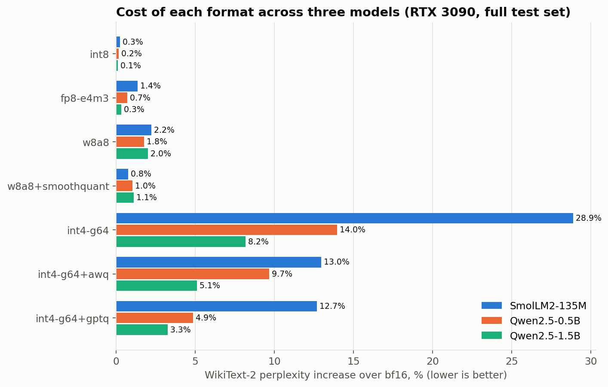
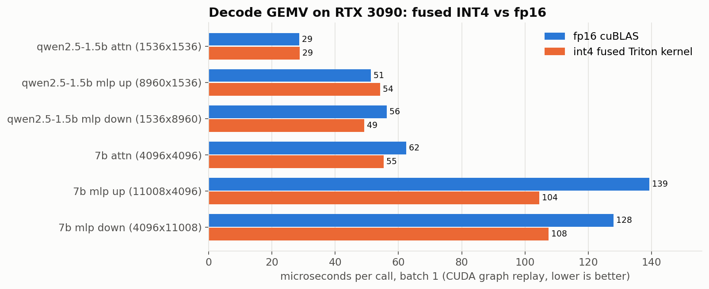
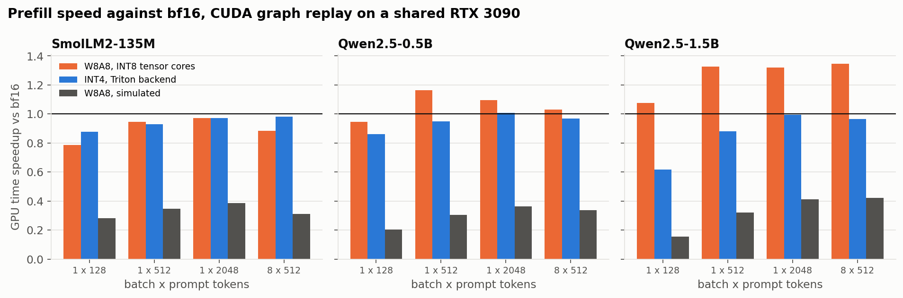
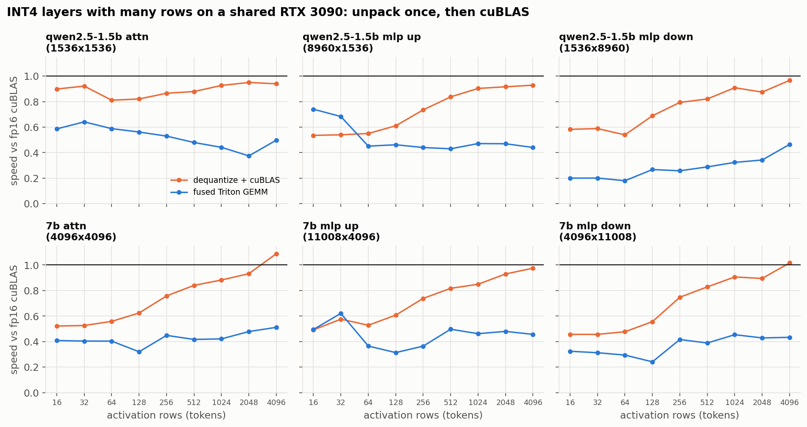
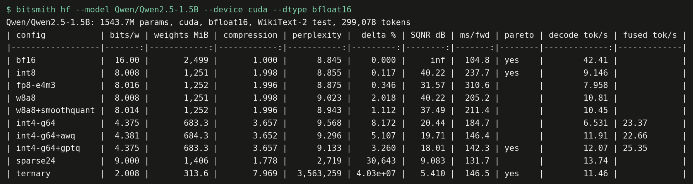
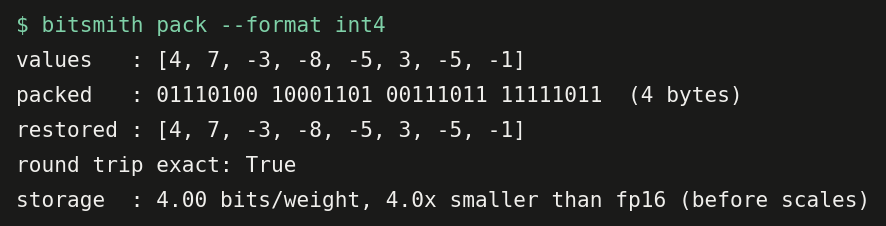
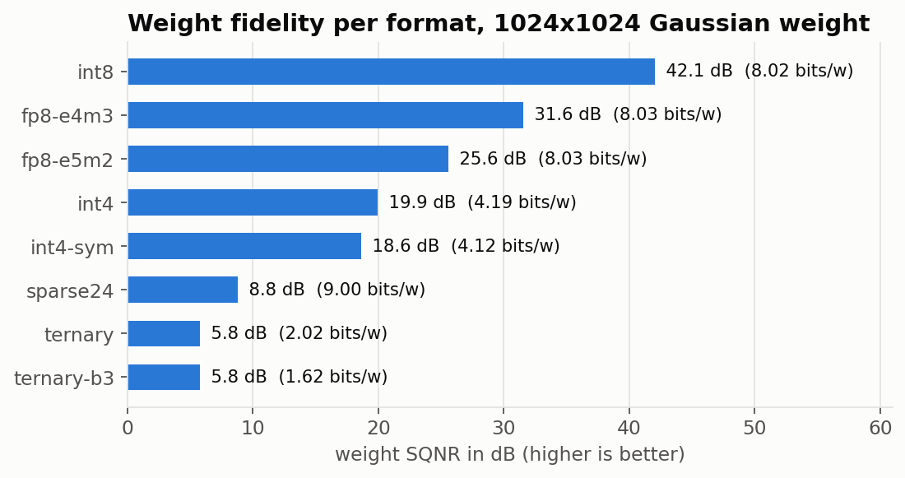
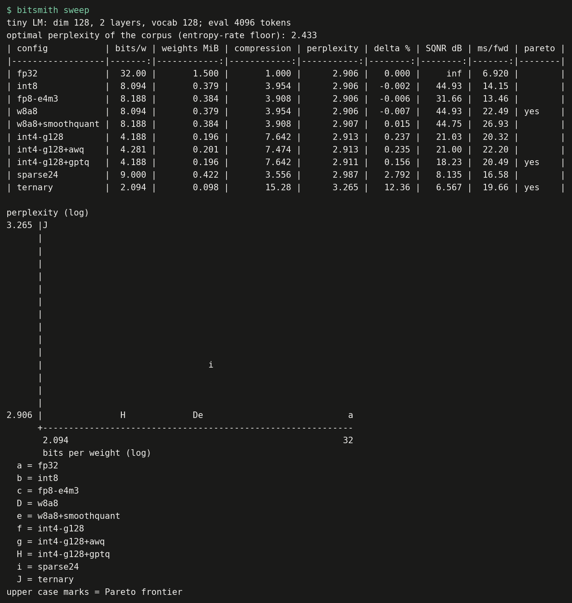

# bitsmith

**LLM weight quantization from first principles, in pure PyTorch, with a fused INT4 GPU kernel.**


[](https://github.com/yashwanthdevavarapu/bitsmith/actions/workflows/ci.yml)


[](LICENSE)
[](https://github.com/yashwanthdevavarapu/bitsmith/labels/good%20first%20issue)

bitsmith implements the core of modern LLM compression in readable Python, runs it on
real models, and reports what each technique actually costs:

- **Formats**: INT8, group-wise INT4, INT3 and INT2, NF4, OCP FP8 (E4M3 and E5M2, bit exact), OCP
  microscaling (MXFP4, MXINT8), BitNet style ternary, and 2:4 structured sparsity
- **Storage**: real sub-byte packing into `uint8` (INT4 nibbles, INT3 in 24-bit words, INT2,
  2-bit and base-3 ternary, 2:4 values plus index metadata), so checkpoints actually shrink
  on disk
- **KV cache**: INT8 to INT2 keys and values with per-channel or per-token groups, as a
  drop-in `transformers` cache
- **Calibration**: SmoothQuant, AWQ and GPTQ (block-sequential, with activation ordering),
  with GPTQ working on INT4, INT3, INT2, NF4 and MX alike
- **Kernels and runtime**: a fused INT4 dequantize + matmul in Triton (up to 1.33x faster than
  fp16 cuBLAS at batch 1), real INT8 W8A8 on tensor cores (prefill 1.19x to 1.39x faster
  than bf16 on Qwen2.5-1.5B), and CUDA graph decoding (1.9x to 9x faster than `generate`)
- **Evaluation**: full WikiText-2 perplexity on three models, kernel timing against the
  bandwidth roofline, and a Pareto sweep
- **Engineering**: 347 CPU tests at 97% coverage plus 124 GPU tests, CI on Linux, Windows and
  macOS, and 20 architecture decision records

The core library depends only on `torch` and `numpy`.

---

## Contents

- [Results](#results)
- [Quickstart](#quickstart)
- [Command line](#command-line)
- [Python API](#python-api)
- [How it works](#how-it-works)
- [More results](#more-results)
- [Project layout](#project-layout)
- [Testing and CI](#testing-and-ci)
- [Design decisions](#design-decisions)
- [Reproducing everything](#reproducing-everything)
- [Limitations](#limitations)
- [Roadmap](#roadmap)
- [Contributing](#contributing)
- [Citation](#citation)
- [License](#license)

---

## Results

### Quality on three models

Full WikiText-2 raw test split (about 300,000 tokens), window 1024, stride 512, bf16 on an
NVIDIA RTX 3090. INT4 uses group size 64. Calibration uses 128 sequences of 512 tokens from
the train split. `lm_head` stays in bf16. Bits per weight include every scale, zero point
and metadata byte. Cells show the perplexity increase over bf16 (lower is better).



| Config | Bits/weight | SmolLM2-135M | Qwen2.5-0.5B | Qwen2.5-1.5B |
|--------|------------:|-------------:|-------------:|-------------:|
| bf16 baseline (perplexity) | 16 | 14.82 | 12.51 | 8.84 |
| **8 bits** | | | | |
| int8 | 8.02 | +0.3% | +0.2% | **+0.1%** |
| mxint8 (OCP MX) | 8.25 | **+0.2%** | **+0.1%** | **+0.1%** |
| fp8-e4m3 | 8.05 | +1.4% | +0.7% | +0.3% |
| w8a8 (int8 weights and activations) | 8.02 | +2.2% | +1.8% | +2.0% |
| w8a8 + SmoothQuant | 8.03 | +0.9% | +0.8% | +0.9% |
| **4 bits** | | | | |
| int4, round to nearest | 4.38 | +28.9% | +14.0% | +8.2% |
| int4 + AWQ | 4.40 | +13.0% | +9.7% | +5.1% |
| int4 + GPTQ | 4.38 | +12.7% | +4.9% | +3.3% |
| nf4, round to nearest | 4.25 | +24.8% | +10.9% | +6.9% |
| nf4 + AWQ | 4.27 | +11.8% | +8.6% | +5.3% |
| nf4 + GPTQ | 4.25 | **+10.6%** | **+4.3%** | **+3.0%** |
| mxfp4 (OCP MX), round to nearest | 4.25 | +60.7% | +22.7% | +12.6% |
| mxfp4 + AWQ | 4.27 | +33.8% | +22.4% | +11.5% |
| mxfp4 + GPTQ | 4.25 | +16.7% | +9.0% | +5.4% |
| **3 and 2 bits** | | | | |
| int3, round to nearest | 3.38 | +322% | +132% | +76% |
| int3 + GPTQ | 3.38 | **+73%** | **+28%** | **+19%** |
| int2 + GPTQ | 2.38 | +5,814% | +2,085% | +568% |
| **Needs training** | | | | |
| 2:4 sparse, no fine tuning | 9.00 | model breaks | model breaks | model breaks |
| ternary, post training | 2.02 | model breaks | model breaks | model breaks |

The best config at each size, per model (faint dots are every other config):


**What the numbers say**

1. **8-bit weights are close to free.** INT8 and MXINT8 cost 0.1% to 0.3% at 2x compression over
   bf16. FP8 E4M3 costs a little more, since 3 mantissa bits give coarser steps near the
   per-channel maximum than 8 uniform bits.
2. **SmoothQuant fixes activation quantization.** Quantizing activations to INT8 as well
   (W8A8) raises the loss from about 0.2% to about 2%, because a few activation channels are
   far larger than the rest. Moving that range into the weights cuts it by 2.3x to 2.6x.
   bitsmith picks the smoothing strength per layer from calibration data, including not
   smoothing at all; a fixed strength broke GPT-2 (see below and ADR 0018).
3. **4 bits needs calibration, and GPTQ wins.** Round to nearest costs 7% to 61% on these
   small models. Block-sequential GPTQ with activation ordering cuts that by 2.3x to 3.6x
   and beats AWQ on every model and every 4-bit format.
4. **NF4 is the best 4-bit grid.** Its levels follow the bell shape of the weights, so it
   beats INT4 both with and without calibration while using fewer bits (4.25 against 4.38).
   NF4 + GPTQ is the best 4-bit result on all three models.
5. **MXFP4 trades quality for hardware.** Each block of 32 shares a power-of-two scale, so
   the largest weight lands anywhere from 4 to 8 on a grid that ends at 6: blocks either
   clip or leave levels unused. Round to nearest is 1.8x to 2.5x worse than NF4. GPTQ
   recovers most of it; AWQ barely helps, because its scales get rounded into the same
   power-of-two block exponent. MXINT8, on the other hand, is as good as INT8.
6. **3 bits works only with GPTQ, 2 bits not at all.** GPTQ turns INT3 from unusable
   (+76% to +322%) into a real option at 4.7x compression (+19% on 1.5B). At 2 bits even
   GPTQ cannot save a model this small.
7. **Bigger models tolerate fewer bits.** Every gap shrinks from 135M to 1.5B parameters,
   and the frontier curves move down in the same order.
8. **Ternary and 2:4 need training.** Both formats are stored and executed correctly (the
   tests prove the round trips are exact), but they destroy a model that was not trained
   or fine tuned for them.

Raw data: [`results/gpu_*.json`](results). Full tables with timing:
[SmolLM2-135M](results/gpu_smollm2_135m.txt), [Qwen2.5-0.5B](results/gpu_qwen2.5_0.5b.txt),
[Qwen2.5-1.5B](results/gpu_qwen2.5_1.5b.txt). NF4, MX, low-bit and SmoothQuant runs:
`results/gpu_formats*`, `results/gpu_lowbit_*`, `results/gpu_smoothquant_*`.

### A fourth family: GPT-2

GPT-2 stores its projections as `transformers` `Conv1D` layers, which bitsmith converts to
equivalent `nn.Linear` layers before quantizing (exact, tested), so every method runs
unchanged. Full WikiText-2 test split, same settings
([`results/gpu_gpt2.txt`](results/gpu_gpt2.txt)):

| Config | Bits/weight | GPT-2 (124M) |
|--------|------------:|-------------:|
| bf16 baseline (perplexity) | 16 | 25.43 |
| int8 | 8.02 | +0.06% |
| w8a8 | 8.02 | +0.71% |
| w8a8 + SmoothQuant, fixed alpha 0.5 (old default) | 8.03 | +73% |
| w8a8 + SmoothQuant, per-layer search | 8.03 | **+0.50%** |
| int4, round to nearest | 4.38 | +7.4% |
| int4 + AWQ | 4.39 | +5.7% |
| int4 + GPTQ | 4.38 | **+4.1%** |
| nf4 + GPTQ | 4.25 | +4.4% |
| int3 + GPTQ | 3.38 | +31% |

GPT-2 is where a fixed SmoothQuant strength failed. The input of an MLP down projection
has channels that rarely fire. Calibration sees them small, smoothing scales them up 13x,
and when one fires on new text it takes over the token's INT8 range. Choosing per layer
on calibration data (which may mean no smoothing) fixes it. Unlike on the other models,
INT4 + GPTQ edges out NF4 + GPTQ here.

### KV cache: keys must be grouped per channel

The weights are fixed, but the cache of past keys and values grows with every token: 28 KiB
per token for Qwen2.5-1.5B in bf16, so 0.9 GiB for one 32k-token sequence. `bitsmith kv`
stores it at 8 to 2 bits per number and measures WikiText-2 perplexity through a real
`transformers` cache, evaluated chunk by chunk so it matches token-by-token decoding
exactly (ADR 0015). Weights stay in bf16; cells show the perplexity increase over a bf16
cache.


| Cache (`k` keys, `v` values, `c` per channel) | Bits/element | Cache size | SmolLM2-135M | Qwen2.5-0.5B | Qwen2.5-1.5B |
|-----------------------------------------------|-------------:|-----------:|-------------:|-------------:|-------------:|
| bf16 baseline (perplexity) | 16 | 1x | 14.82 | 12.51 | 8.85 |
| `k8v8`: INT8, per token | 8.5 | 1.9x smaller | **+0.05%** | +3.5% | **+0.5%** |
| `k4v4`: INT4, per token | 4.5 | 3.6x smaller | +8.3% | +878% | model breaks |
| `k4cv4`: INT4, keys per channel | 4.5 | 3.6x smaller | +1.2% | **+1.1%** | +0.8% |
| `k3cv3`: INT3, keys per channel | 3.5 | 4.6x smaller | +6.1% | +6.3% | +4.3% |
| `k2v2`: INT2, per token | 2.5 | 6.4x smaller | model breaks | model breaks | model breaks |
| `k2cv2`: INT2, keys per channel | 2.5 | 6.4x smaller | +93% | +115% | +67% |

1. **How keys are grouped matters more than how many bits they get.** A few key channels
   are large for every token: in a typical head the largest channel is 6x to 10x the median
   one, up to 270x in Qwen2.5-1.5B, while values stay at 2.5x to 3.8x
   ([`results/kv_channels.txt`](results/kv_channels.txt)). A per-token grid stretches over
   those channels and rounds the rest away. With per-channel groups, 4-bit keys cost about
   1% on every model, while 4-bit keys per token break both Qwen models.
2. **On Qwen2.5-0.5B, 4 bits per channel beats 8 bits per token** (+1.1% against +3.5%) at
   half the memory.
3. **3 bits is usable, 2 bits is not yet.** INT3 with per-channel keys shrinks the cache
   4.6x for 4% to 6%; INT2 still costs 67% to 115%.

Full tables: [`results/kv_*.txt`](results). The cache stores packed codes, but attention
still reads a dequantized copy, so this saves memory, not time; a fused attention kernel
is on the [roadmap](ROADMAP.md).

### Weights and KV cache together

`bitsmith kv --weights nf4+gptq` quantizes the weights with GPTQ first, then runs every
cache format on the quantized model. Memory is everything the model holds (packed weights,
bf16 embeddings and norms) plus the cache for one sequence of 32k tokens; the perplexity
increase is against the bf16 model with a bf16 cache.


| Weights + cache | SmolLM2-135M | Qwen2.5-0.5B | Qwen2.5-1.5B |
|-----------------|-------------:|-------------:|-------------:|
| bf16 + bf16 (memory at 32k) | 977 MiB | 1,326 MiB | 3,840 MiB |
| nf4 + GPTQ, bf16 cache | 828 MiB, +10.6% | 825 MiB, +4.3% | 2,005 MiB, +3.0% |
| nf4 + GPTQ, `k8v8` cache | 490 MiB, +10.6% | 645 MiB, +8.1% | 1,585 MiB, +3.6% |
| nf4 + GPTQ, `k4cv4` cache | **310 MiB, +12.2%** | **549 MiB, +5.6%** | **1,361 MiB, +4.0%** |
| nf4 + GPTQ, `k3cv3` cache | 265 MiB, +19.0% | 525 MiB, +11.7% | 1,305 MiB, +7.9% |

- **At long context the cache is the bigger half.** SmolLM2's bf16 cache at 32k tokens is
  2.8x its whole model, so quantizing the weights alone saves only 15%. With a `k4cv4`
  cache as well, memory drops 3.1x.
- **The costs roughly add.** On Qwen2.5-1.5B, NF4 weights cost +3.0% and a `k4cv4` cache
  about +0.8% alone; together +4.0%, for 2.8x less memory.
- **Per-channel keys matter here too:** on Qwen2.5-0.5B an 8-bit per-token cache costs more
  (+8.1%) than a 4-bit per-channel one (+5.6%) at twice the size.

Full tables: [`results/kv_nf4_*.txt`](results).

### Speed: fused INT4 kernel on an RTX 3090

The reference runtime unpacks the whole weight before each matmul, so it is 5x to 20x
slower than fp16. The Triton kernel ([`kernels/int4_triton.py`](src/bitsmith/kernels/int4_triton.py))
dequantizes in registers instead. Times are CUDA graph replays of a single layer, batch 1:



| Layer (out x in) | fp16 cuBLAS | int4 reference | int4 fused | Fused vs fp16 |
|------------------|------------:|---------------:|-----------:|--------------:|
| Qwen2.5-1.5B attention (1536 x 1536) | 28.7 us | 155.6 us | 28.8 us | 1.00x |
| Qwen2.5-1.5B MLP up (8960 x 1536) | 51.2 us | 791.5 us | 54.3 us | 0.94x |
| Qwen2.5-1.5B MLP down (1536 x 8960) | 56.3 us | 797.7 us | 49.2 us | **1.15x** |
| 7B attention (4096 x 4096) | 62.5 us | 959.5 us | 55.3 us | **1.13x** |
| 7B MLP up (11008 x 4096) | 139.3 us | 2,546 us | 104.4 us | **1.33x** |
| 7B MLP down (4096 x 11008) | 128.0 us | 2,528 us | 107.5 us | **1.19x** |

At batch 1 the kernel is up to 1.33x faster than cuBLAS on 4 of 6 layers and within 6% on
the other two, while reading 3.8x fewer weight bytes, and it is 5x to 24x faster than the
reference path. It reaches about 25% of the 3090's 936 GB/s,
against 70% for cuBLAS fp16, so a hand-tuned CUDA kernel (as in Marlin) would be several
times faster still. At 512 rows (prefill) it is about 2x slower than cuBLAS. Full data:
[`results/kernels_rtx3090.txt`](results/kernels_rtx3090.txt).

### Speed: end to end decoding with CUDA graphs

At batch 1 a decode step is a few hundred tiny kernels, and through `generate` launching
them takes longer than running them. `GraphDecoder` (ADR 0016) captures one step as a CUDA
graph and replays it per token. Greedy decoding, 64-token prompt, 128 new tokens
([`results/decode_rtx3090_shared.txt`](results/decode_rtx3090_shared.txt)):

| Model | Weights, kernel | `generate` tok/s | Graph tok/s | Gain |
|-------|-----------------|-----------------:|------------:|-----:|
| SmolLM2-135M | bf16 | 34.0 | 306.7 | 9.0x |
| SmolLM2-135M | int4, fused | 21.3 | 115.7 | 5.4x |
| Qwen2.5-0.5B | bf16 | 39.2 | 122.7 | 3.1x |
| Qwen2.5-0.5B | int4, fused | 24.7 | 107.7 | 4.4x |
| Qwen2.5-1.5B | bf16 | 34.4 | 64.4 | 1.9x |
| Qwen2.5-1.5B | int4, fused | 21.5 | 64.0 | 3.0x |

- **Launch overhead was the bottleneck.** Every configuration decodes 1.9x to 9x faster from
  a graph. On the Qwen models INT4 on the fused kernel gains more than bf16 (3.0x to 4.4x
  against 1.9x to 3.1x), so it now runs within 12% of bf16 instead of about 37% behind.
- **Exact.** Graph replay produces the same tokens as running the step eagerly in all nine
  runs. Against `generate`, which uses a dynamic cache and different attention shapes, bf16
  rounding can flip a near tie: for Qwen2.5-0.5B the two best first tokens have exactly
  equal bf16 logits, and in fp32 the static-cache prompt pass matches a plain forward pass
  to 2e-5.
- **Measured on a shared GPU.** All eight GPUs of the machine were busy with other jobs.
  A second run gave the same picture but absolute tokens/s that differed by up to 2x, so
  compare rows within one run, not across them.

### Speed: real INT8 W8A8

The `int8` backend (ADR 0017) multiplies INT8 activations by INT8 weights on tensor cores
(`torch._int_mm`), with fused Triton kernels to quantize each token and to rescale the
INT32 result. Single layers, CUDA graph replay, same shared GPU
([`results/int8_rtx3090_shared.txt`](results/int8_rtx3090_shared.txt)):

| Layer (out x in) | Rows | fp16 cuBLAS | W8A8 simulated | W8A8 int8 | int8 vs fp16 |
|------------------|-----:|------------:|---------------:|----------:|-------------:|
| Qwen2.5-1.5B attention (1536 x 1536) | 1 | 16.4 us | 108.5 us | 21.5 us | 0.76x |
| Qwen2.5-1.5B attention (1536 x 1536) | 512 | 56.3 us | 186.4 us | 46.1 us | 1.22x |
| Qwen2.5-1.5B MLP up (8960 x 1536) | 1 | 46.1 us | 399.4 us | 37.9 us | 1.22x |
| Qwen2.5-1.5B MLP up (8960 x 1536) | 512 | 258.0 us | 705.0 us | 157.7 us | 1.64x |
| 7B attention (4096 x 4096) | 1 | 59.4 us | 483.3 us | 41.0 us | 1.45x |
| 7B attention (4096 x 4096) | 512 | 327.7 us | 959.5 us | 163.8 us | 2.00x |
| 7B MLP up (11008 x 4096) | 128 | 266.2 us | 1,335 us | 117.8 us | 2.26x |

Real W8A8 is 3x to 12x faster than the simulated path the accuracy results use, and faster
than fp16 on 28 of 30 layer and batch shapes (1.04x to 2.26x up to 512 rows); only the
smallest layer at 1 to 16 rows is slower. Before the two Triton kernels, the PyTorch
quantize and rescale steps took more time than the GEMM and the backend lost to fp16 on
every Qwen2.5-1.5B layer.

### Speed: W8A8 makes a whole model faster

Layer timings leave out attention, norms and the residual stream, which stay in bf16. The
end to end test is prefill, the forward pass over the prompt, whose linear layers have as
many rows as there are tokens (ADR 0019). Speed against bf16, CUDA graph replay, the
configurations timed in interleaved rounds on the shared GPU, perplexity on the first 32k
WikiText-2 test tokens from the same backend
([`results/prefill_rtx3090_shared.txt`](results/prefill_rtx3090_shared.txt)):

| Qwen2.5-1.5B | 1 x 128 | 1 x 512 | 1 x 2048 | 8 x 512 | Perplexity |
|--------------|--------:|--------:|---------:|--------:|-----------:|
| bf16 (cuBLAS) | 9.9 ms | 30.3 ms | 110.6 ms | 211.6 ms | 10.100 |
| W8A8 SmoothQuant, INT8 tensor cores | **1.19x** | **1.26x** | **1.32x** | **1.39x** | 10.200 (+1.0%) |
| W8A8 SmoothQuant, simulated | 0.20x | 0.34x | 0.43x | 0.46x | 10.216 |
| INT4-g64, fused Triton | 0.37x | 0.43x | 0.49x | 0.51x | 11.001 |



1. **W8A8 is 1.19x to 1.39x faster than bf16 on Qwen2.5-1.5B** for +1.0% perplexity, and the
   gain grows with the number of tokens. It is the first configuration in bitsmith that
   speeds up a whole model, not only a layer.
2. **Model size decides.** On Qwen2.5-0.5B W8A8 is at parity (0.89x to 1.05x), on
   SmolLM2-135M slower (0.65x to 0.99x): their layers are too small for the INT8 GEMM to
   outweigh the two extra kernels around it.
3. **Without graphs, short prompts lose.** W8A8 launches three kernels per layer instead of
   one, so a plain PyTorch call is launch bound on short prompts (49 ms eager against 24 ms
   of GPU work at 1 x 512 on Qwen2.5-1.5B): 0.44x to 0.65x eager up to 512 tokens, 1.30x at
   1 x 2048 and 1.36x at 8 x 512.
4. **The real and simulated backends agree** on perplexity (10.200 and 10.216), so the
   accuracy tables above hold for the fast path.
5. **INT4 is for decoding, not prefill.** The fused INT4 GEMM ran at about half of cuBLAS
   speed on many rows; the next section fixes most of that, but INT4 cannot beat bf16 on
   prefill. It pays off at batch 1 decode, where weight bandwidth is the limit.

### Speed: INT4 prefill, unpack once and call cuBLAS

With many rows the fused INT4 GEMM is compute bound and dequantizes the same weights for
every block of rows. For those shapes `int4_linear` now unpacks the weight once with a
Triton kernel and calls cuBLAS (ADR 0020). The switch point comes from measuring six layer
shapes at 16 to 4096 rows ([`results/int4_prefill_rtx3090_shared.txt`](results/int4_prefill_rtx3090_shared.txt)):

| Rows | Fused GEMM vs fp16 | Unpack + cuBLAS vs fp16 |
|-----:|-------------------:|------------------------:|
| 64 | 0.18x to 0.59x | 0.48x to 0.81x |
| 512 | 0.29x to 0.50x | 0.82x to 0.88x |
| 2048 | 0.34x to 0.48x | 0.87x to 0.95x |
| 4096 | 0.43x to 0.51x | 0.93x to 1.09x |



From 256 rows on, INT4 layers are 1.6x to 3.1x faster than before. In a whole model,
SmolLM2-135M prefill with INT4 weights went from 0.43x to 0.70x of bf16 to 0.88x to 0.98x
(CUDA graph replay,
[`results/prefill_int4dequant_smollm2_135m_shared.txt`](results/prefill_int4dequant_smollm2_135m_shared.txt)).
Below 64 rows the fused GEMM still wins on wide layers, so the rule is per shape: unpack
when there are 64 rows or more, or when the layer is not wider than it is long. Decoding
keeps the fused GEMV.



---

## Quickstart

```bash
git clone https://github.com/yashwanthdevavarapu/bitsmith.git && cd bitsmith
python -m venv .venv && source .venv/bin/activate     # Windows: .venv\Scripts\activate
pip install torch --index-url https://download.pytorch.org/whl/cpu   # or a CUDA build for the GPU kernel
pip install -e ".[dev,plot]"                           # add ,hf for real model evaluation

make check            # lint, types and the full test suite
bitsmith info
```

## Command line

| Command | What it does |
|---------|--------------|
| `bitsmith info` | version, available schemes and hardware profiles |
| `bitsmith pack --format int4\|int3\|int2\|ternary\|ternary-b3\|sparse24` | shows the exact bit layout of a format and checks the round trip |
| `bitsmith sqnr --shape 1024x1024 --outliers 8` | weight error of every scheme on a random matrix |
| `bitsmith sweep` | trains a tiny LM on a synthetic corpus and runs the full sweep (about 1 minute on CPU) |
| `bitsmith roofline --params 7e9 --hardware rtx3090` | bandwidth-bound decode speed per format |
| `bitsmith hf --model Qwen/Qwen2.5-0.5B --device cuda --dtype bfloat16 --eval-tokens 0` | WikiText-2 perplexity, size and decode speed for any causal LM |
| `bitsmith kv --model Qwen/Qwen2.5-0.5B --device cuda --dtype bfloat16 --configs k8v8 k4cv4` | perplexity and memory with a quantized KV cache |



## Python API

**One layer**

```python
import torch
from torch import nn
from bitsmith import QLinear

linear = nn.Linear(4096, 4096)
q = QLinear.from_linear(linear, scheme="int4", group_size=128)

y = q(torch.randn(2, 4096))
print(q)                  # QLinear(in_features=4096, out_features=4096, scheme=int4, bits_per_weight=4.188)
print(q.qweight.dtype)    # torch.uint8, two codes per byte
```

Schemes: `int8`, `int4`, `int4-sym`, `fp8-e4m3`, `fp8-e5m2`, `ternary`, `ternary-b3`, `sparse24`.

**A whole model, calibrated, on the GPU kernel**

```python
from bitsmith import calibrate_and_quantize
from bitsmith.nn import set_backend

calib = [train_ids[i : i + 512].unsqueeze(0).cuda() for i in range(0, 65536, 512)]
report = calibrate_and_quantize(model, calib, method="gptq", scheme="int4", group_size=64)
print(report.summary())

set_backend(model, "triton")                       # fused INT4 kernel for every int4 layer
torch.save(model.state_dict(), "model-int4.pt")    # packed buffers, not floats
```

Other methods: `method="awq"`, and `method="smoothquant", scheme="int8", act_bits=8` for W8A8.

**A quantized KV cache**

```python
from bitsmith.kv import parse_kv_spec
from bitsmith.kv.hf import quantized_cache

cache = quantized_cache(parse_kv_spec("k4cv4"))    # 4-bit keys per channel, values per token
out = model.generate(ids, past_key_values=cache, max_new_tokens=64)
print(cache.nbytes)                                # bytes actually stored
```

**Fast decoding**

```python
from bitsmith.decode import GraphDecoder

set_backend(model, "triton")                       # or "int8" for W8A8 layers
decoder = GraphDecoder(model, max_len=2048)        # static cache, one CUDA graph per step
new_ids = decoder.generate(prompt_ids, new_tokens=128)
```

**Building blocks** are importable on their own: `bitsmith.quant` (quantizers, FP8),
`bitsmith.packing` (bit layouts), `bitsmith.calib` (`gptq_quantize`, `awq_search`,
`smoothing_factors`), `bitsmith.kernels` (`int4_linear`), `bitsmith.eval`
(`sliding_window_perplexity`, `sqnr_db`).

## How it works

```
                 nn.Linear weight (out x in)
                            |
          +-----------------+------------------+
          |                                    |
   calib/ (block by block)               quant/ + packing/
   SmoothQuant: x/s, W*s                 uniform affine/symmetric, FP8, ternary
   AWQ: grid search s                    INT4 nibbles, 2-bit/base-3 trits, 2:4 meta
   GPTQ: act-order OBS updates           NF4 table, MX E8M0 + FP4/INT8 blocks
          |                                    |
          +----------------> nn/codecs.py <----+
                            encode -> uint8/int8 buffers + fp16 scales
                                       |
                              nn/QLinear  (state_dict = packed form)
                     reference: decode -> F.linear | triton: fused int4 kernel
                                       |
                   eval/ perplexity, SQNR      bench/ sweep, roofline, HF, kernels
```

Short version of the math (the [technical guide](docs/guide/README.md) has the full
derivations and byte layouts):

| Piece | Core formula |
|-------|--------------|
| Affine quantization | `s = (x_hi - x_lo) / (2^b - 1)`, `z = round(-x_lo / s)`, `q = clamp(round(x / s) + z)` |
| Symmetric quantization | `s = max\|x\| / (2^(b-1) - 1)`, `q = clamp(round(x / s))` |
| INT4 packing | `byte = (v0 & 0xF) \| (v1 & 0xF) << 4`, sign extend with `(n ^ 8) - 8` |
| Ternary packing | 4 trits per byte as `t + 1` in 2-bit fields, or 5 per byte in base 3 |
| 2:4 sparsity | keep top 2 of every 4, metadata nibble `idx0 \| idx1 << 2` |
| SmoothQuant | `s_j = max\|X_j\|^a / max\|W_j\|^(1-a)`, `Y = (X / s)(W s)^T` |
| AWQ | `s = mean\|X\|^a`, pick `a` minimizing `\|\|XW^T - (X/s) Q(Ws)^T\|\|^2` |
| GPTQ | `e = (w_i - q_i) / U_ii`, `w_j -= e U_ij` with `U = chol(H^-1)`, `H = 2X^TX/n`, columns by decreasing `diag(H)` |
| Decode roofline | `time per token >= weight bytes / DRAM bandwidth` |

## More results

### Weight fidelity per format

1024x1024 Gaussian weight, group size 128 ([`results/cli_sqnr.txt`](results/cli_sqnr.txt)
adds 8 outlier columns).



### Calibration on controlled data

[`examples/02_calibration.py`](examples/02_calibration.py), 512x512 layer, 4,096 inputs
with correlated channels and three 40x outlier channels:

| Method | Metric | Before | After |
|--------|--------|-------:|------:|
| SmoothQuant | W8A8 output SQNR | 27.45 dB | 40.06 dB (+12.6 dB) |
| SmoothQuant | max change of the exact product in fp32 | | 3.8e-6 (invariant) |
| AWQ | INT4 output MSE | 1.12e-1 | 2.49e-2 (4.5x lower) |
| GPTQ | INT4 expected output error `tr(dW H dW^T)` | 112.3 | 53.4 (2.1x lower) |
| GPTQ with act-order | INT4 expected output error `tr(dW H dW^T)` | 112.3 | 21.5 (5.2x lower) |

### Decode roofline

Batch 1 decoding reads every weight once per token at `16 / bits` FLOP per byte, far below
every accelerator's ridge point, so it is bandwidth bound
([`results/example_03_roofline.txt`](results/example_03_roofline.txt)):

| Model | Format | Weights | RTX 3050 Laptop bound | A100 40GB bound | Speedup |
|-------|--------|--------:|----------------------:|----------------:|--------:|
| 7B | fp16 | 14.0 GB | 13.7 tok/s | 111 tok/s | 1.0x |
| 7B | int8 | 7.0 GB | 27.4 tok/s | 222 tok/s | 2.0x |
| 7B | int4, group 128 | 3.7 GB | 52.4 tok/s | 424 tok/s | 3.8x |
| 7B | ternary | 1.8 GB | 109.5 tok/s | 887 tok/s | 8.0x |

### Synthetic pipeline check

`bitsmith sweep` trains a 2-layer transformer on a Markov corpus whose optimal perplexity
is known exactly (2.433), then sweeps every config. It runs in CI in about a minute.



## Project layout

```
src/bitsmith/
  quant/       uniform.py (affine, symmetric, groups), fp8.py (E4M3, E5M2), nf4.py,
               mx.py (MXFP4, MXINT8), ternary.py
  packing/     int4.py, lowbit.py (INT3, INT2), ternary.py (2-bit and base-3), sparse24.py
  nn/          codecs.py (one class per format), qlinear.py, convert.py
  calib/       capture.py (hooks), smoothquant.py, awq.py, gptq.py, pipeline.py
  kernels/     int4_triton.py (fused GEMV and GEMM), int8_mm.py (real W8A8)
  eval/        metrics.py, perplexity.py, corpus.py (Markov), tiny_lm.py
  kv/          quant.py (KV grids, streams), hf.py (transformers cache, exact evaluation)
  decode.py    GraphDecoder: static cache, one CUDA graph per decode step
  bench/       pareto.py, roofline.py, hf.py (WikiText-2)
  report.py    plain text tables and scatter plots
  cli.py       the bitsmith command
tests/
  unit/        one file per module
  e2e/         CLI, full train-quantize-evaluate-reload pipeline, opt-in real model test
  gpu/         CUDA parity and fused kernel tests (skipped without a GPU)
examples/      01 quickstart, 02 calibration, 03 roofline, 04 real model
scripts/       reproduce.py, make_figures.py, bench_kernels.py, bench_int8.py, bench_decode.py,
               bench_prefill.py, bench_int4_prefill.py, bench_gptq.py, kv_channel_stats.py
docs/          guide/ (math, layouts, kernel), adr/ (20 decision records), assets/ (figures)
results/       every committed number, as JSON and text
.github/       CI, benchmark and release workflows, issue and PR templates
```

## Testing and CI

```bash
make check       # ruff lint + format check, mypy, pytest
make test-fast   # skip the slow end to end tests
make coverage    # HTML coverage report
pytest tests/gpu # on a CUDA machine: 124 GPU tests
```

What the tests pin down, beyond "it runs":

- every quantizer stays within half a step of the input, for every bit width and granularity
- about 6 dB of SQNR per extra bit
- FP8 encoding matches PyTorch's native float8 casts **bit for bit** on 45,000 values
- known byte layouts for INT4, both ternary packings and 2:4 metadata
- every scheme survives awkward widths (9, 36, 100), half precision with bias, and a
  `state_dict` round trip, and gives the same result on CUDA as on CPU
- the fused kernel matches the reference for fp16 and bf16, group sizes 32 to 128,
  symmetric and asymmetric codes, padded widths and 1 to 300 rows
- SmoothQuant is mathematically invariant; GPTQ (with or without act-order) equals round to
  nearest when `H` is diagonal and beats it on correlated inputs; AWQ never loses to its
  own baseline
- perplexity of a uniform model is exactly the vocabulary size, every token is scored once
  for any window and stride, and an oracle reaches the corpus entropy floor
- a trained model keeps the expected quality ordering after quantization, and a packed
  checkpoint reloads bit for bit at under 60% of the float file size

GitHub Actions ([`.github/workflows`](.github/workflows)):

| Workflow | Trigger | Jobs |
|----------|---------|------|
| `ci.yml` | push, pull request | ruff, mypy, dash check; tests on Linux, Windows, macOS x Python 3.10, 3.11, 3.12; coverage gate at 90%; wheel build, CLI and examples smoke test |
| `benchmark.yml` | weekly, manual | regenerates the CPU results and figures, uploads artifacts |
| `release.yml` | tag `v*.*.*` | checks tag against version, builds sdist and wheel, GitHub release, optional PyPI trusted publishing |

## Design decisions

Recorded in [`docs/adr/`](docs/adr/README.md):

| ADR | Decision |
|-----|----------|
| [0002](docs/adr/0002-quantization-conventions.md) | symmetric range `[-7, 7]` for INT4, affine range always contains 0, fp16 scales rounded before coding |
| [0003](docs/adr/0003-ternary-storage.md) | 2-bit ternary by default, base-3 (1.6 bits) optional |
| [0004](docs/adr/0004-reference-runtime.md) | a readable dequantize-then-matmul runtime stays the default and the source of truth |
| [0006](docs/adr/0006-synthetic-benchmark.md) | Markov corpus with a known floor and a tiny LM, so CI needs no downloads |
| [0007](docs/adr/0007-input-scale-buffer.md) | explicit `input_scale` buffer instead of folding into norm layers |
| [0008](docs/adr/0008-minimal-dependencies.md) | the core depends on `torch` and `numpy` only |
| [0009](docs/adr/0009-block-sequential-calibration.md) | block-sequential calibration and act-order GPTQ with static groups (replaces 0005) |
| [0010](docs/adr/0010-fused-int4-triton-kernel.md) | fused INT4 Triton kernel as an optional backend, and the variants that lost |
| [0011](docs/adr/0011-lookup-and-microscaling-formats.md) | NF4 table computed from the normal quantiles; MX formats follow OCP MX v1.0 exactly, clipping included |
| [0012](docs/adr/0012-gptq-on-grid-formats.md) | GPTQ on any block-scale grid through a small `TableCodec` interface |
| [0013](docs/adr/0013-fast-gptq-loop.md) | GPTQ loop on transposed weights with two-level lazy updates and CUDA graph replay; float32 Hessian factor on GPUs |
| [0014](docs/adr/0014-int3-int2-packing.md) | INT3 and INT2 are asymmetric only; INT3 packs 8 codes into a 24-bit word |
| [0015](docs/adr/0015-kv-cache-quantization.md) | KV cache with per-channel keys and per-token values; evaluated in chunks that match token-by-token decoding exactly |
| [0016](docs/adr/0016-cuda-graph-decoding.md) | decode with a static cache and the one-token step replayed from a CUDA graph |
| [0017](docs/adr/0017-int8-w8a8-backend.md) | real W8A8 on `torch._int_mm`, with the same activation codes as the simulated path |
| [0018](docs/adr/0018-smoothquant-per-layer-search.md) | SmoothQuant picks its strength per layer on calibration data, including no smoothing |
| [0019](docs/adr/0019-end-to-end-w8a8-prefill.md) | W8A8 measured end to end on prefill (eager and CUDA graph), input scale fused into quantization |
| [0020](docs/adr/0020-int4-prefill-dequantize-then-cublas.md) | INT4 with many rows unpacks the weight once and calls cuBLAS, switch point measured per shape |

## Reproducing everything

```bash
python scripts/reproduce.py         # CPU results and figures, no downloads, about 2 minutes
python scripts/reproduce.py --gpu   # plus the kernel benchmark and three model sweeps (CUDA + Triton)
```

GPU results: NVIDIA RTX 3090 (24 GB), PyTorch 2.5.1 with CUDA 12.1, Triton 3.1,
Transformers 4.57. CPU results: Windows 11, Python 3.11, PyTorch 2.6 CPU build. Quality
numbers are deterministic for a given PyTorch version; timings depend on the machine. See
[`results/README.md`](results/README.md).

## Limitations

- The fused kernel reaches about 25% of peak bandwidth; production CUDA kernels go further.
- CUDA graph decoding (`GraphDecoder`) is batch 1 and greedy only, with a 16-bit cache.
- The INT8 backend is slower than fp16 on small layers at 1 to 16 rows; activations are
  quantized in a separate kernel rather than inside the previous layer. End to end it only
  pays off on larger models: prefill is at or below bf16 speed on the 135M and 0.5B models.
- INT4 prefill reaches 0.9x to 1.0x of bf16 by unpacking the weight once, never more: it
  does the bf16 GEMM plus the unpacking.
- Speed results were measured on a shared RTX 3090 under load from other jobs.
- The quantized KV cache saves memory, not time: attention reads a dequantized copy.
- Results cover models up to 1.5B parameters.
- See the [roadmap](ROADMAP.md) for how each of these is being addressed.

## Roadmap

| Milestone | Focus |
|-----------|-------|
| v0.3: Speed | CUDA graph decode, faster INT4 GEMV, real INT8 tensor core matmul, faster GPTQ |
| v0.4: Formats | NF4, MXFP4 and MXINT8, INT3 and INT2, KV-cache quantization |
| v0.5: Models | GPT-2 `Conv1D` support, folding scales into norms, 7B results |

Details and the matching issues are in [ROADMAP.md](ROADMAP.md) and the
[milestones](https://github.com/yashwanthdevavarapu/bitsmith/milestones).

## Contributing

Contributions are welcome, from typo fixes to new kernels.

- New here? Pick a [good first issue](https://github.com/yashwanthdevavarapu/bitsmith/labels/good%20first%20issue);
  each one lists the files to change and how to test it.
- Bigger features are labelled [help wanted](https://github.com/yashwanthdevavarapu/bitsmith/labels/help%20wanted).
- Questions and ideas go to [Discussions](https://github.com/yashwanthdevavarapu/bitsmith/discussions).
- Results from your own GPU are very useful: open a
  [benchmark result](https://github.com/yashwanthdevavarapu/bitsmith/issues/new?template=benchmark_result.yml) issue.

Read [CONTRIBUTING.md](CONTRIBUTING.md) for setup, standards and the pull request process,
and the [Code of Conduct](CODE_OF_CONDUCT.md). Security problems: see [SECURITY.md](SECURITY.md).

## Citation

If bitsmith helps your work, please cite it using [CITATION.cff](CITATION.cff) (GitHub shows
a "Cite this repository" button in the sidebar).

## License

[Apache License 2.0](LICENSE). Contributions are accepted under the same license.
